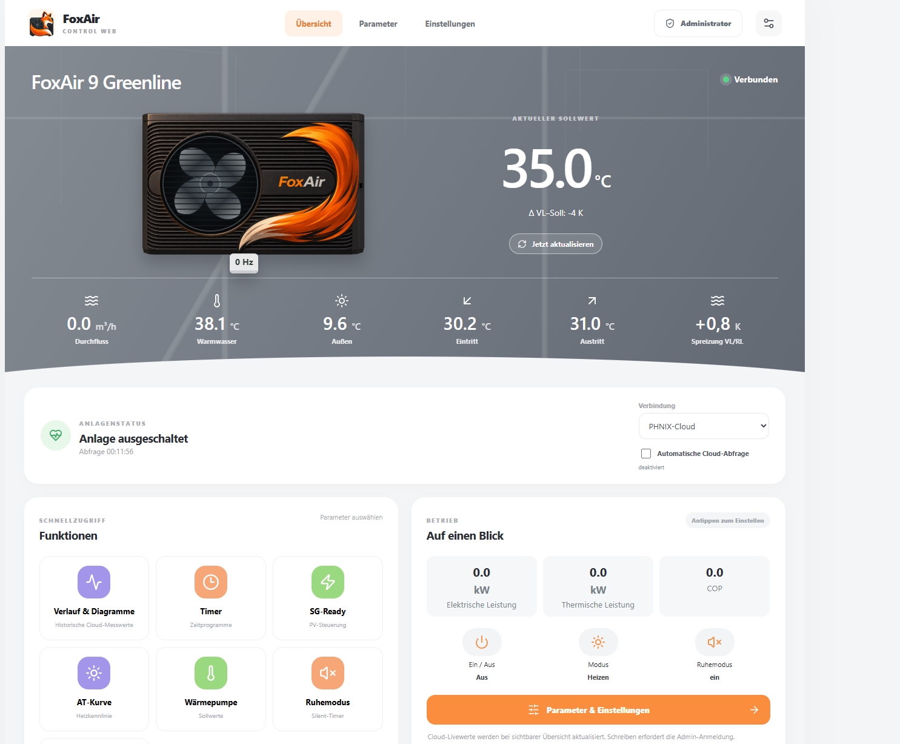
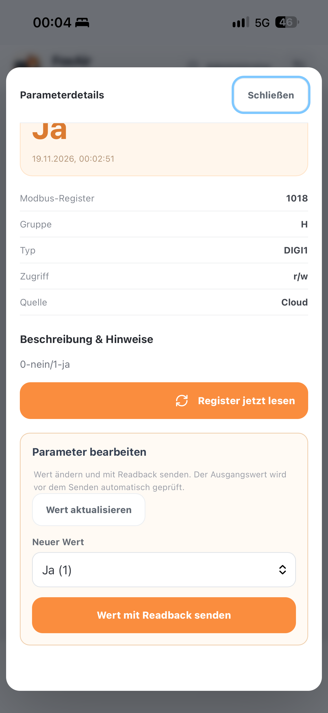

# FoxAir Control Web

**Deine FoxAir-/PHNIX-Wärmepumpe im Browser – am PC, auf dem iPhone oder als App auf dem Homescreen.**

FoxAir Control Web zeigt Livewerte, Anlagenstatus und Parameter. Die App läuft auf deinem eigenen Server und unterstützt Cloud sowie lokale Modbus-Anschlüsse.

[Docker im Heimnetz](#docker-im-heimnetz) · [Linux mit systemd](#linux-mit-systemd) · [Verbindungen](#verbindungen) · [Releases](https://github.com/dosordie/FoxAir_Control_Web/releases) · [Changelog](CHANGELOG.md)

> **Beta.** Die verfügbaren Werte und Funktionen hängen von Anlage und Verbindung ab. Prüfe nach Parameteränderungen den zurückgelesenen Wert.



<table>
  <tr>
    <th>Übersicht</th>
    <th>Parameterliste</th>
    <th>Parameterdetails</th>
  </tr>
  <tr>
    <td><a href="docs/screenshots/dashboard-iphone.png"></a></td>
    <td><a href="docs/screenshots/parameters-iphone.png"></a></td>
    <td><a href="docs/screenshots/parameter-details-iphone.png"></a></td>
  </tr>
</table>

## Docker im Heimnetz

Auf einem Linux-Host mit Docker und Compose starten. Das öffentliche Image für Linux amd64 enthält Backend und Weboberfläche.

```bash
mkdir -p ~/foxweb
cd ~/foxweb
wget -O compose.yaml.tmp https://raw.githubusercontent.com/dosordie/FoxAir_Control_Web/main/compose.lan.yaml &&
mv compose.yaml.tmp compose.yaml &&
docker compose up -d
```

Im Browser `http://<LAN-IP-des-Hosts>:18081` oder den DNS-Namen des Hosts mit Port `18081` öffnen. Bei der ersten Einrichtung legt der erste Besucher direkt ein Admin-Passwort fest. FoxAir speichert den dafür verwendeten Namen. Weitere Namen lassen sich als Administrator unter **Einstellungen → Webzugriff** direkt speichern. Falls der neue Name noch gesperrt ist, FoxAir zuerst über seine LAN-IP öffnen. Namen aus `FOXAIR_LAN_HOSTS` in `.env` gelten weiterhin.

Das Datenvolume enthält Konten und Verbindungen. Updates im **gleichen Compose-Ordner** ziehen das aktuelle Release, während Compose das Volume weiterverwendet:

```bash
docker compose pull && docker compose up -d
```

Der direkte LAN-Modus verwendet HTTP. Verwende ihn im vertrauenswürdigen Heimnetz. Für HTTPS, Reverse Proxy oder Portainer siehe die [Docker-Anleitung](docs/INSTALLATION_DOCKER.md).

## Linux mit systemd

Auf einem Linux-Host mit systemd, Python 3.12, venv und sudo den Installer aus dem freigegebenen Quellstand holen und ausführen. Der Installer prüft das aktuelle Stable-Paket und richtet die passende Python-Umgebung ein.

```bash
wget -O foxair-source.tar.gz https://github.com/dosordie/FoxAir_Control_Web/archive/refs/tags/v0.1.8.tar.gz
mkdir -p foxair-installer
tar -xzf foxair-source.tar.gz --strip-components=1 -C foxair-installer
sudo python3.12 foxair-installer/scripts/install_release.py
sudo bash /opt/foxair-web/app/scripts/install_service.sh
sudo systemctl enable foxair-web.service
```

Der Dienst lauscht zunächst auf `127.0.0.1:8081`. Für die Ersteinrichtung den Einmalcode als Dienstbenutzer abrufen:

```bash
cd /opt/foxair-web/app
sudo -u foxair-web /opt/foxair-web/venv/bin/python -m backend.setup
```

Dann lokal, per SSH-Tunnel oder über einen HTTPS-Reverse-Proxy öffnen und das Admin-Passwort festlegen. Docker und Linux erhalten dieselbe Release-Version und denselben Quellstand. Die Linux-Testinstallation auf `work` hat einen eigenen Web-Build und Updateweg. [Linux-Anleitung](docs/INSTALLATION.md) · [Updates und Rollback](docs/RELEASES.md)

## Verbindungen

Unter **Einstellungen → Verbindungseinstellungen** den Anschluss einrichten und anschließend in der Übersicht auswählen.

| Verbindung | Verwendung |
| --- | --- |
| **Cloud** | PHNIX/WarmLink mit Geräteauswahl, Liveabfrage und historischen Diagrammen. |
| **Modbus-Standard** | Eigener Modbus-RTU-Anschluss über IP/TCP oder USB-RS485. Die Verbindung bleibt während der Browser-Sitzung offen. |
| **Modbus-LTE** | WarmLink-/LTE-Bus über transparentes TCP oder USB-RS485, mit Livewerten und einstellbarer Verbindungsdauer. |
| **Modbus-Display** | Passiver Empfang über TCP oder USB-RS485, mit manueller Abfrage aller Register. |

Die **Live-Registerübersicht** zeigt eingehende Werte. In den Parameterdetails stehen Quelle, Zeitstempel und Beschreibung. Unterstützte Änderungen werden mit Readback geprüft. [Lokale Modbus-Anschlüsse](docs/LOCAL_MODBUS.md) · [Gira HomeServer](docs/GIRA.md)

## Hilfe und Mitwirkung

Bei einer Fehlermeldung bitte Version, Verbindungstyp und Schritte zum Nachstellen nennen. Entferne persönliche Daten und Zugangsdaten aus Screenshots und Protokollen. [Issue melden](https://github.com/dosordie/FoxAir_Control_Web/issues) · [Entwicklung und Wartung](docs/MAINTENANCE.md)

Registerkatalog und Beschreibungen stammen aus einem geprüften Stand von [FoxAir Control](https://github.com/dosordie/FoxAir_Control). Das Desktop-Programm wird für die Web-App nicht benötigt.

[MIT-Lizenz](LICENSE) · Copyright (c) 2026 DosOrDie
