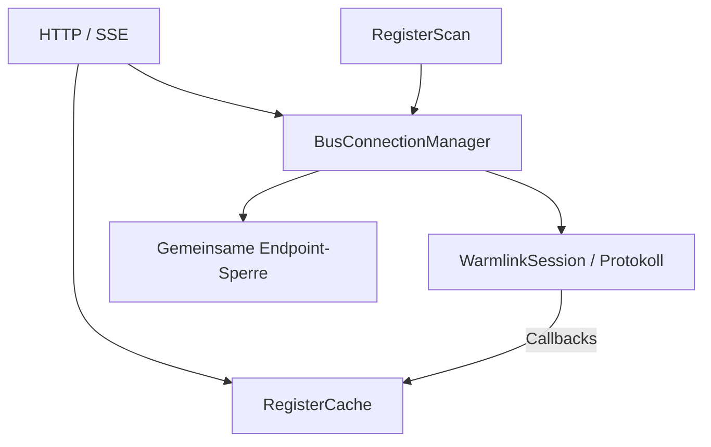

# Zuständigkeiten und Wartung

## Backend

- `warmlink_protocol.py`: Telegramme, Ruhefenster, CRC-geprüfte Antworten,
  Fremdanfragen und Echo. Kennt weder HTTP noch den globalen Cache/Manager.
- `register_cache.py`: quellgebundene aktive/beobachtete Werte, Zeitstempel,
  öffentliche Projektion und Veraltung. Netzwerkfrei und mit injizierbarer Uhr
  testbar. Kein Messwert ist ein Schreib-Readback.
- `bus_connection.py`: genau ein `BusConnectionManager` pro API-Prozess besitzt
  Socket, Browser-Lease und Hintergrundempfang. Explizites Starten/Beenden,
  abbrechbare Wartezeiten; keine Wiederholung unklarer Schreibvorgänge.
- `bus_locks.py`: gemeinsame öffentliche Sperrschnittstelle für physische
  TCP-Endpunkte. Kein Adapter importiert private Sperren eines anderen Adapters.
- `register_scan.py`: ein gemeinsam genutzter `RegisterScan` mit Fortschritt,
  Deduplizierung und Abbruch vor dem nächsten Block. Shutdown wartet begrenzt
  auf den laufenden Vorgang; er startet keinen Ersatzauftrag.
- `register_definitions.py`: gemeinsam verwendete, bestätigte MAIN-Adressen und
  LTE-Blockgrenzen. Kein Ersatz für die noch offene generierte Cloud-Zuordnung.
- `diagnostics.py`: begrenztes, bereinigtes Ereignisprotokoll für alle Transporte.
- `routes/lte.py`: HTTP-/SSE-Darstellung. Cache-Lesen startet keinen Buszugriff.
- `main.py`: API-Zusammenbau und Lebenszyklus. Beim Beenden zuerst Scan abbrechen,
  danach Empfang/Verbindung beenden. Die vorhandenen fünf Sekunden Uvicorn-
  Beendigungsfrist für offene SSE-Clients gelten weiter.



Das Protokoll erhält Cache-Callbacks vom Besitzer. Es importiert den Besitzer
nicht zurück. Tests erzeugen isolierte Manager/Caches mit Socket-Fabrik und Uhr,
statt globale Registerwörter zu manipulieren.

## Frontend

- `useLteConnection`: besitzt EventSource, Lebenszeichen-Timer, Cache und Scanstatus.
  Schließt beim Unmount; verwirft Ergebnisse aus alten Transportgenerationen.
- `useAdminSession`: Anmeldung/Abmeldung, Berechtigungszustand und kurzlebiger
  Passwortentwurf. Keine Speicherung des Passworts im Browser.
- `useConnectionSettings`: private Verbindungsdaten. Abmeldung/Unmount beendet
  die gültige Anfragegeneration und leert private Felder.
- `AppHeader`, `UpdatePanel`, `ConnectionSettingsDialog`: eigene UI-Zuständigkeiten.
  Die Hauptkomponente koordiniert weiterhin Übersicht, Parameter und Bedienaktionen;
  sie ist noch kein vollständig abgeschlossener Umbau aller Ansichten.

Für neue Funktionen zuerst die fachliche Zuständigkeit wählen. Kein neuer
Socket-/Authentifizierungszustand in der Hauptkomponente. Neue Requests müssen
bei Navigation, Transportwechsel und Abmeldung ihre Gültigkeit prüfen.

## Prüfungen

```text
python -m unittest discover -s backend/tests
python scripts/sync_registers.py --check
npm ci --prefix frontend
npm test --prefix frontend
npm run build --prefix frontend
npm run format:check --prefix frontend
```

Vitest prüft reale Vue-Lebenszyklen mit einer lokalen DOM-Umgebung; die bisherigen
API-Regressionen bleiben erhalten. Transporttests prüfen echte synthetische
Telegramme, Socket-Besitz, parallele Aufträge und Shutdown. Hardwareabnahme bleibt
separat. Formatierung wird für die ausgegliederten Module mit Prettier/Ruff
geprüft; ältere Dateien werden schrittweise migriert, um funktionale Änderungen
im Review nicht unter rein kosmetischen Diffs zu verstecken.
