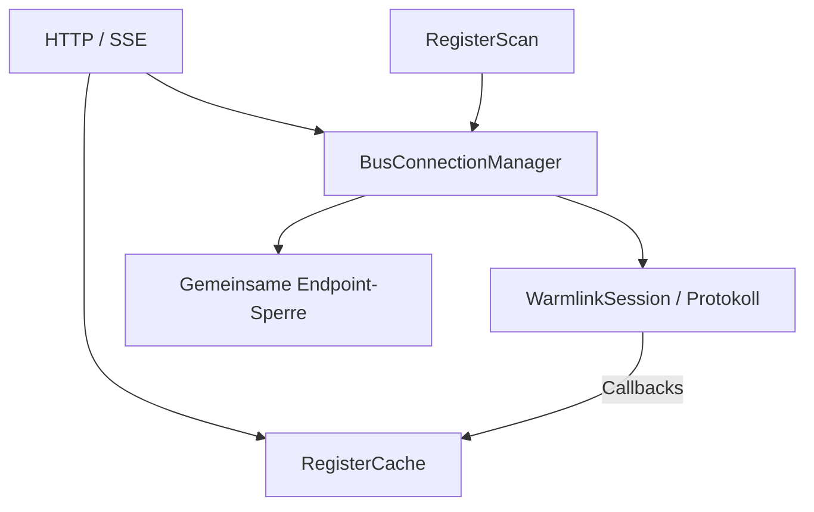

# Zuständigkeiten und Wartung

## Backend

- `warmlink_protocol.py`: Telegramme, Ruhefenster, CRC-geprüfte Antworten,
  Fremdanfragen und Echo. Kennt weder HTTP noch den globalen Cache/Manager.
- `register_cache.py`: quellgebundene aktive/beobachtete Werte, Zeitstempel,
  öffentliche Projektion und Veraltung. Netzwerkfrei und mit injizierbarer Uhr
  testbar. Kein Messwert ist ein Schreib-Readback.
- `bus_connection.py`: genau ein `BusConnectionManager` pro API-Prozess besitzt
  Socket, Browser-Lease und Hintergrundempfang. Explizites Starten/Beenden,
  abbrechbare Wartezeiten; keine Wiederholung unklarer Schreibvorgänge.
- `bus_locks.py`: gemeinsame öffentliche Sperrschnittstelle für physische
  TCP-Endpunkte. Kein Adapter importiert private Sperren eines anderen Adapters.
- `register_scan.py`: ein gemeinsam genutzter `RegisterScan` mit Fortschritt,
  Deduplizierung und Abbruch vor dem nächsten Block. Shutdown wartet begrenzt
  auf den laufenden Vorgang; er startet keinen Ersatzauftrag.
- `register_definitions.py`: gemeinsam verwendete, bestätigte MAIN-Adressen und
  LTE-Blockgrenzen. Kein Ersatz für die noch offene generierte Cloud-Zuordnung.
- `diagnostics.py`: begrenztes, bereinigtes Ereignisprotokoll für alle Transporte.
- `routes/lte.py`: HTTP-/SSE-Darstellung. Cache-Lesen startet keinen Buszugriff.
- `main.py`: API-Zusammenbau und Lebenszyklus. Beim Beenden zuerst Scan abbrechen,
  danach Empfang/Verbindung beenden. Die vorhandenen fünf Sekunden Uvicorn-
  Beendigungsfrist für offene SSE-Clients gelten weiter.



Das Protokoll erhält Cache-Callbacks vom Besitzer. Es importiert den Besitzer
nicht zurück. Tests erzeugen isolierte Manager/Caches mit Socket-Fabrik und Uhr,
statt globale Registerwörter zu manipulieren.

## Frontend

- `useLteConnection`: besitzt EventSource, Lebenszeichen-Timer, Cache und Scanstatus.
  Schließt beim Unmount; verwirft Ergebnisse aus alten Transportgenerationen.
- `useAdminSession`: Anmeldung/Abmeldung, Berechtigungszustand und kurzlebiger
  Passwortentwurf. Keine Speicherung des Passworts im Browser.
- `useConnectionSettings`: private Verbindungsdaten. Abmeldung/Unmount beendet
  die gültige Anfragegeneration und leert private Felder.
- `useRegisterCatalog`: Suche, Gruppen, Ladefehler und Anfragenummern. Alte
  Suchantworten dürfen neue Ergebnisse nicht überschreiben. Katalogabfragen
  starten keine Modbus-Leseaufträge.
- `useRegisterFavorites`: speichert ausschließlich Register-IDs pro Browser.
  Der Katalogfilter greift vor dem Trefferlimit; auch Favoriten außerhalb der
  ersten 200 Standardtreffer bleiben auffindbar. Keine impliziten Schreibrechte.
- `AppHeader`, `UpdatePanel`, `ConnectionSettingsDialog`: eigene UI-Zuständigkeiten.
  Die Hauptkomponente koordiniert weiterhin Übersicht, Parameter und Bedienaktionen;
  sie ist noch kein vollständig abgeschlossener Umbau aller Ansichten.

Für neue Funktionen zuerst die fachliche Zuständigkeit wählen. Kein neuer
Socket-/Authentifizierungszustand in der Hauptkomponente. Neue Requests müssen
bei Navigation, Transportwechsel und Abmeldung ihre Gültigkeit prüfen.

## Prüfungen

```text
python -m unittest discover -s backend/tests
python scripts/sync_registers.py --check
npm ci --prefix frontend
npm test --prefix frontend
npm run build --prefix frontend
npm run format:check --prefix frontend
```

Vitest prüft reale Vue-Lebenszyklen mit einer lokalen DOM-Umgebung; die bisherigen
API-Regressionen bleiben erhalten. Transporttests prüfen echte synthetische
Telegramme, Socket-Besitz, parallele Aufträge und Shutdown. Hardwareabnahme bleibt
separat. Formatierung wird für die ausgegliederten Module mit Prettier/Ruff
geprüft; ältere Dateien werden schrittweise migriert, um funktionale Änderungen
im Review nicht unter rein kosmetischen Diffs zu verstecken.


## Gemeinsame letzte Werte und Parameterbearbeitung

`backend/last_values.py` speichert Engineering-Werte mit Ursprungsquelle und unverändertem
Zeitstempel in der privaten SQLite-Datei `last-register-values.sqlite` im State-Verzeichnis.
Cloud und lokale Busse teilen diesen Speicher; ein Wechsel der konfigurierten Geräteidentität
verwendet einen getrennten Bereich. Zwischengespeicherte Werte beweisen keine aktive Verbindung
und sind keine Schreibberechtigung. Cloud-Zahlen werden nicht erneut wie Modbus-Rohwörter skaliert.

`routes/parameters.py` prüft beim Öffnen einer Gruppe die sichtbaren Register. Werte derselben
Verbindung, die höchstens 60 Sekunden alt sind, werden weiterverwendet. Veraltete benachbarte
Register werden in FC03-Abfragen mit maximal 90 Wörtern gelesen. Während einer laufenden
LTE-Initialisierung übernimmt deren vorhandener Live-Stream die Aktualisierung.

`parameter_write.py` verwendet die Schreibrechte und Datentypen des MAIN-Katalogs. Cloud-Grants,
Enums und bestätigte Grenzen werden durch `export_cloud_catalog.py` aus dem festgelegten
Desktop-Stand exportiert. Fehlende Cloud-Zuordnungen werden nicht geraten; hierfür ist Modbus
zu verwenden. Direkte Engineering-Register erfordern Standard-Modbus. Timerbearbeitung nutzt
auch aus den Parameterdetails die vollständigen Timer-Prüfungen und Freigabestufen.
Jeder Auftrag prüft den Ausgangswert frisch, schreibt einmal und bestätigt per Readback.
R01/R02/R03 berücksichtigen die aktuell gelesenen Sollwertgrenzen.

LTE-Verbindungseinstellungen bieten zusätzlich `idle_timeout_seconds` (0–3600, Standard 0)
und `browser_timeout_seconds` (30–3600, Standard 90). Im Bedarfsmodus verlängert jede
abgeschlossene Operation die Leerlaufzeit; passives Empfangen verlängert sie nicht.
Der Dauermodus bleibt unabhängig davon offen.


### Ergänzung: abgelaufene Fremdabfragen und direkte Bearbeitung

Eine beobachtete FC03-Anfrage belegt nur ihr begrenztes Antwortzeitfenster. Der LTE-Parser
verwirft nach dessen Ablauf die Zuordnung einschließlich Mehrdeutigkeitsmarker; er übernimmt
keine verspätete Antwort in den Cache. Die normale Ruhephase und die Kollisions-/CRC-Prüfung
bleiben erforderlich. Insbesondere wird kein abgebrochener Schreibauftrag wiederholt.

Der Parametereditor übernimmt vorhandene bekannte Werte direkt als optimistische Baseline.
Bei einem Quellenwechsel wird deren Skalierung serverseitig konvertiert. Das Backend liest
vor jeder Änderung den aktuellen Wert und lehnt Konflikte weiterhin ab. Live-Aktualisierungen
überschreiben keinen bereits bearbeiteten Entwurf. Ohne gültigen Ausgangswert bleibt manuelles
Aktualisieren verfügbar. Parametertexte vereinen Beschreibung, Wissen, Erläuterungen und Notizen
aus MAIN und Knowledge; Cloud-Code-Details verwenden dieselbe Projektion.

Die kompakte Hz-Anzeige nutzt Frequenz/90 als Balkenanteil (28 Hz rund 31 %, 0 Hz leer).
Dies ist ein Frequenzanteil, keine elektrische oder thermische Leistungsangabe. Der Lüfterstatus
verwendet gültige Drehzahlen, ersatzweise Kompressor-/Ein-Aus-Werte, statt den Gesamtstatus
aller Messwerte als Voraussetzung zu verwenden.


## PWA und Spezialdialoge

Der Produktionsbuild erzeugt `sw.js` mit einer aus den statischen Dateien abgeleiteten
Cache-Version. Nur die öffentliche Oberfläche wird gespeichert. API-Abfragen, fremde
Origins und alle POSTs werden nie durch den Service Worker beantwortet oder wiederholt.
Eine Offline-Navigation zeigt die Oberfläche mit Offlinehinweis; die API blockiert POSTs
schon vor dem Senden, wenn der Browser ausdrücklich offline ist. Neue Worker erzwingen
keinen Reload während einer Bearbeitung. Beim Aktivieren werden nur alte FoxAir-Shellcaches
entfernt. Die Installation erfolgt ausschließlich im sicheren Kontext (HTTPS/Loopback).
Ein physisches iPhone/Safari-Homescreen bleibt eine gesonderte Geräteabnahme.

`SpecialControls.vue` stellt SG, AT und WP als bearbeitbare Karten dar. Es verwendet den
bestehenden Parametereditor und dessen individuelle Preflight-/Readback-Prüfung; es sendet
keine implizite Folge mehrerer Parameter. Die AT-Grafik zeigt gespeicherte Werte mit R10/R11-
Begrenzung. Der 0-°C-Stützpunkt ist 1235, nicht ein angenommener CP1-4-Code. Die sieben
Stützstellen stammen aus `core/at_compensation.py` des festgelegten Desktop-Standes.
Änderungen an Kurvenpunkten werden auch serverseitig gegen aktuelle R10/R11 geprüft.
Virtueller SG-Eingang 8801 bleibt dem bestätigten direkten Standard-Modbus vorbehalten.
