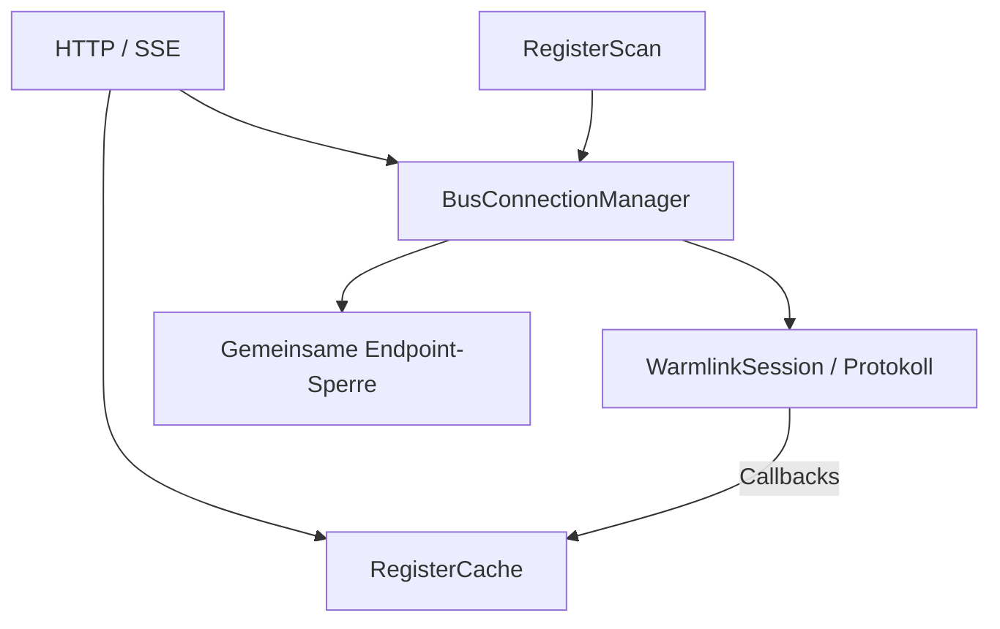

# Zuständigkeiten und Wartung

## Backend

- `warmlink_protocol.py`: Telegramme, Ruhefenster, CRC-geprüfte Antworten,
  Fremdanfragen und Echo. Kennt weder HTTP noch den globalen Cache/Manager.
- `register_cache.py`: quellgebundene aktive/beobachtete Werte, Zeitstempel,
  öffentliche Projektion und Veraltung. Netzwerkfrei und mit injizierbarer Uhr
  testbar. Kein Messwert ist ein Schreib-Readback.
- `bus_connection.py`: genau ein `BusConnectionManager` pro API-Prozess besitzt
  Socket, Browser-Lease und Hintergrundempfang. Explizites Starten/Beenden,
  abbrechbare Wartezeiten; keine Wiederholung unklarer Schreibvorgänge.
- `bus_locks.py`: gemeinsame öffentliche Sperrschnittstelle für physische
  TCP-Endpunkte. Kein Adapter importiert private Sperren eines anderen Adapters.
- `register_scan.py`: ein gemeinsam genutzter `RegisterScan` mit Fortschritt,
  Deduplizierung und Abbruch vor dem nächsten Block. Shutdown wartet begrenzt
  auf den laufenden Vorgang; er startet keinen Ersatzauftrag.
- `register_definitions.py`: gemeinsam verwendete, bestätigte MAIN-Adressen und
  LTE-Blockgrenzen. Kein Ersatz für die noch offene generierte Cloud-Zuordnung.
- `diagnostics.py`: begrenztes, bereinigtes Ereignisprotokoll für alle Transporte.
- `routes/lte.py`: HTTP-/SSE-Darstellung. Cache-Lesen startet keinen Buszugriff.
- `main.py`: API-Zusammenbau und Lebenszyklus. Beim Beenden zuerst Scan abbrechen,
  danach Empfang/Verbindung beenden. Die vorhandenen fünf Sekunden Uvicorn-
  Beendigungsfrist für offene SSE-Clients gelten weiter.



Das Protokoll erhält Cache-Callbacks vom Besitzer. Es importiert den Besitzer
nicht zurück. Tests erzeugen isolierte Manager/Caches mit Socket-Fabrik und Uhr,
statt globale Registerwörter zu manipulieren.

## Frontend

- `useLteConnection`: besitzt EventSource, Lebenszeichen-Timer, Cache und Scanstatus.
  Schließt beim Unmount; verwirft Ergebnisse aus alten Transportgenerationen.
- `useAdminSession`: Anmeldung/Abmeldung, Berechtigungszustand und kurzlebiger
  Passwortentwurf. Keine Speicherung des Passworts im Browser.
- `useConnectionSettings`: private Verbindungsdaten. Abmeldung/Unmount beendet
  die gültige Anfragegeneration und leert private Felder.
- `useRegisterCatalog`: Suche, Gruppen, Ladefehler und Anfragenummern. Alte
  Suchantworten dürfen neue Ergebnisse nicht überschreiben. Katalogabfragen
  starten keine Modbus-Leseaufträge.
- `useRegisterFavorites`: speichert ausschließlich Register-IDs pro Browser.
  Der Katalogfilter greift vor dem Trefferlimit; auch Favoriten außerhalb der
  ersten 200 Standardtreffer bleiben auffindbar. Keine impliziten Schreibrechte.
- `AppHeader`, `UpdatePanel`, `ConnectionSettingsDialog`: eigene UI-Zuständigkeiten.
  Die Hauptkomponente koordiniert weiterhin Übersicht, Parameter und Bedienaktionen;
  sie ist noch kein vollständig abgeschlossener Umbau aller Ansichten.

Für neue Funktionen zuerst die fachliche Zuständigkeit wählen. Kein neuer
Socket-/Authentifizierungszustand in der Hauptkomponente. Neue Requests müssen
bei Navigation, Transportwechsel und Abmeldung ihre Gültigkeit prüfen.

## Prüfungen

```text
python -m unittest discover -s backend/tests
python scripts/sync_registers.py --check
npm ci --prefix frontend
npm test --prefix frontend
npm run build --prefix frontend
npm run format:check --prefix frontend
```

Vitest prüft reale Vue-Lebenszyklen mit einer lokalen DOM-Umgebung; die bisherigen
API-Regressionen bleiben erhalten. Transporttests prüfen echte synthetische
Telegramme, Socket-Besitz, parallele Aufträge und Shutdown. Hardwareabnahme bleibt
separat. Formatierung wird für die ausgegliederten Module mit Prettier/Ruff
geprüft; ältere Dateien werden schrittweise migriert, um funktionale Änderungen
im Review nicht unter rein kosmetischen Diffs zu verstecken.


## Gemeinsame letzte Werte und Parameterbearbeitung

`backend/last_values.py` speichert Engineering-Werte mit Ursprungsquelle und unverändertem
Zeitstempel in der privaten SQLite-Datei `last-register-values.sqlite` im State-Verzeichnis.
Cloud und lokale Busse teilen diesen Speicher; ein Wechsel der konfigurierten Geräteidentität
verwendet einen getrennten Bereich. Zwischengespeicherte Werte beweisen keine aktive Verbindung
und sind keine Schreibberechtigung. Cloud-Zahlen werden nicht erneut wie Modbus-Rohwörter skaliert.

`routes/parameters.py` prüft beim Öffnen einer Gruppe die sichtbaren Register. Werte derselben
Verbindung, die höchstens 60 Sekunden alt sind, werden weiterverwendet. Veraltete benachbarte
Register werden in FC03-Abfragen mit maximal 90 Wörtern gelesen. Während einer laufenden
LTE-Initialisierung übernimmt deren vorhandener Live-Stream die Aktualisierung.

`parameter_write.py` verwendet die Schreibrechte und Datentypen des MAIN-Katalogs. Cloud-Grants,
Enums und bestätigte Grenzen werden durch `export_cloud_catalog.py` aus dem festgelegten
Desktop-Stand exportiert. Fehlende Cloud-Zuordnungen werden nicht geraten; hierfür ist Modbus
zu verwenden. Direkte Engineering-Register erfordern Standard-Modbus. Timerbearbeitung nutzt
auch aus den Parameterdetails die vollständigen Timer-Prüfungen und Freigabestufen.
Jeder Auftrag prüft den Ausgangswert frisch, schreibt einmal und bestätigt per Readback.
R01/R02/R03 berücksichtigen die aktuell gelesenen Sollwertgrenzen.

LTE-Verbindungseinstellungen bieten zusätzlich `idle_timeout_seconds` (0–3600, Standard 0)
und `browser_timeout_seconds` (30–3600, Standard 90). Im Bedarfsmodus verlängert jede
abgeschlossene Operation die Leerlaufzeit; passives Empfangen verlängert sie nicht.
Der Dauermodus bleibt unabhängig davon offen.


### Ergänzung: abgelaufene Fremdabfragen und direkte Bearbeitung

Eine beobachtete FC03-Anfrage belegt nur ihr begrenztes Antwortzeitfenster. Der LTE-Parser
verwirft nach dessen Ablauf die Zuordnung einschließlich Mehrdeutigkeitsmarker; er übernimmt
keine verspätete Antwort in den Cache. Die normale Ruhephase und die Kollisions-/CRC-Prüfung
bleiben erforderlich. Insbesondere wird kein abgebrochener Schreibauftrag wiederholt.

Der Parametereditor übernimmt vorhandene bekannte Werte direkt als optimistische Baseline.
Bei einem Quellenwechsel wird deren Skalierung serverseitig konvertiert. Das Backend liest
vor jeder Änderung den aktuellen Wert und lehnt Konflikte weiterhin ab. Live-Aktualisierungen
überschreiben keinen bereits bearbeiteten Entwurf. Ohne gültigen Ausgangswert bleibt manuelles
Aktualisieren verfügbar. Parametertexte vereinen Beschreibung, Wissen, Erläuterungen und Notizen
aus MAIN und Knowledge; Cloud-Code-Details verwenden dieselbe Projektion.

Die kompakte Hz-Anzeige nutzt Frequenz/90 als Balkenanteil (28 Hz rund 31 %, 0 Hz leer).
Dies ist ein Frequenzanteil, keine elektrische oder thermische Leistungsangabe. Der Lüfterstatus
verwendet gültige Drehzahlen, ersatzweise Kompressor-/Ein-Aus-Werte, statt den Gesamtstatus
aller Messwerte als Voraussetzung zu verwenden.


## PWA und Spezialdialoge

Der Produktionsbuild erzeugt `sw.js` mit einer aus den statischen Dateien abgeleiteten
Cache-Version. Nur die öffentliche Oberfläche wird gespeichert. API-Abfragen, fremde
Origins und alle POSTs werden nie durch den Service Worker beantwortet oder wiederholt.
Eine Offline-Navigation zeigt die Oberfläche mit Offlinehinweis; die API blockiert POSTs
schon vor dem Senden, wenn der Browser ausdrücklich offline ist. Neue Worker erzwingen
keinen Reload während einer Bearbeitung. Beim Aktivieren werden nur alte FoxAir-Shellcaches
entfernt. Die Installation erfolgt ausschließlich im sicheren Kontext (HTTPS/Loopback).
Ein physisches iPhone/Safari-Homescreen bleibt eine gesonderte Geräteabnahme.

`SpecialControls.vue` stellt SG, AT und WP als bearbeitbare Karten dar. Es verwendet den
bestehenden Parametereditor und dessen individuelle Preflight-/Readback-Prüfung; es sendet
keine implizite Folge mehrerer Parameter. Die AT-Grafik zeigt gespeicherte Werte mit R10/R11-
Begrenzung. Der 0-°C-Stützpunkt ist 1235, nicht ein angenommener CP1-4-Code. Die sieben
Stützstellen stammen aus `core/at_compensation.py` des festgelegten Desktop-Standes.
Änderungen an Kurvenpunkten werden auch serverseitig gegen aktuelle R10/R11 geprüft.
Virtueller SG-Eingang 8801 bleibt dem bestätigten direkten Standard-Modbus vorbehalten.


## Mobile Parameteransicht

`ParameterFilters.vue` besitzt nur die Darstellung von Suche, Favoriten und Gruppen;
Katalogabfragen bleiben beim vorhandenen Composable. Auf schmalen Ansichten teilen sich
Gruppenleiste, Suchsymbol und Stern eine Zeile. Die Suche öffnet ein fokussiertes Feld;
Escape schließt es, ohne einen aktiven Filter unbemerkt zu löschen. Ein aktiver Suchfilter
bleibt am hervorgehobenen Symbol erkennbar. Symbolknöpfe behalten zugängliche Namen.

`LteScanSummary.vue` zeigt Fortschritt, Zahl bekannter Werte und Streamstatus kompakt.
Erklärtexte sind entfernt, Fehler bleiben sichtbar. `ParameterValue.vue` unterscheidet
lange Klartexte von numerischen Messwerten, erlaubt Umbruch und erhält den vollständigen
Wert. Die mobile Registerliste ist mindestens 560 Pixel hoch (zuvor höchstens 270 Pixel).


### Mobile parameter dialogs and startup

- `ParameterDetails.vue` uses the existing detail content in a native modal at widths up to 600px. Opening is explicit on every list click (including the already selected parameter). Desktop retains the side panel. Native close/Escape restores focus; closing leaves list scroll and filters intact. A breakpoint change closes the dialog before replacing its element.
- `ParameterFilters` accepts the source tabs in its default slot. On mobile source buttons, search and favorite icons share the first row; groups have their own full-width scrolling row.
- The app uses system fonts without render-blocking external font CSS and includes an inline loading placeholder before JavaScript mounts.
- Shell navigation tries the network first but falls back to already cached public HTML after 1.5 seconds, continuing the update in the background. With no cached shell it still requires a network response. Prompt 401 responses remain authentication challenges. Same-origin credentials permit shell installation behind Basic Auth. API responses and write requests are never cached or queued.
- iOS standalone cold-start timing and Basic Auth prompts still require verification on a physical iPhone. Changing the reverse-proxy login mechanism is a separate deployment decision; the app admin login only protects writes/admin endpoints, not all telemetry reads.


### Optional proxy SSO

Generic disabled-by-default JSON and Nginx examples are under `deploy/`. Replace the documentation-only IP and example username before use. Keep deployment-specific infrastructure details and secrets outside the repository. SSO must never trust rewritten client IPs; only `backend.server` preserves the TCP peer. Do not bypass `is_admin_session` with the token-storage helper `authenticated`, which only checks whether a stored token exists.


### Accounts, authorization, audit and backups

`backend/users.py` resolves every session against current private account state. Local role/password/status updates invalidate that account's local sessions by changing its version. Proxy SSO requires its existing TCP/secret checks and maps to an existing enabled account; groups never grant permissions. The reserved `admin` bootstrap account retains the existing password and is not editable in the user panel. Named accounts support reader, operator and admin roles. Operators can only write explicitly listed MAIN registers through the parameter editor; system configuration, operational shortcut dialogs and timer program writes remain admin-only. Empty register allowlists grant no writes.

The admin-only panel is under App Settings. Session listings contain hashes, never bearer cookies. Targeted revocation suppresses automatic SSO bootstrap for that revoked cookie; explicit login is still possible for enabled users. Disabling the account is the way to deny future logins. FoxWeb logout does not end the upstream Authelia session. Anonymous API reading remains enabled by default for compatibility, and can be disabled without blocking health checks or login/session routes. Reverse-proxy access protection remains important.

`AccessMiddleware` stores the last 1,000 parameter/control/timer write outcomes in private `audit.json`, with timestamp, actor, endpoint, old/requested value, transport and available confirmation/readback fields. Request and response fields are allowlisted; no password, cloud token or shared secret is copied to the journal. Audit persistence is not a tamper-proof external logging service. A process crash during a physical request can leave the physical outcome unknown; always refresh before retrying.

Backups use Fernet authenticated encryption with a fresh salt and PBKDF2-SHA256 (600,000 iterations). Only users.json, cloud.json, warmlink.json, display_modbus.json and standard_modbus.json are included. Bootstrap admin credentials, session tokens, proxy configuration/secrets, audit records and telemetry caches are excluded. Keep the backup password separately. Restore authenticates and validates the envelope, rolls back file replacements on normal I/O errors, and revokes all sessions after success. This is not a power-loss-atomic multi-file database transaction: stop writes and retain an external server backup before restoring important deployments. SSO environment secrets must be provisioned separately. The existing bootstrap admin password remains available after restore.


### Display and standard TCP buses

See [LOCAL_MODBUS.md](LOCAL_MODBUS.md). `display_protocol.py` owns the deterministic passive decoder and fixed snapshot state machine, `display_bus.py` owns its single socket/thread and lease, and `routes/local_buses.py` exposes protected configuration and live snapshots. No generic display writer exists. Ordinary Modbus retains the separate short-lived RTU client. Configuration enforces distinct physical TCP endpoints; CRC framing is shared without changing LTE request ownership. New encrypted backups include both private bus config files and accept older envelopes.

CI builds are tested locally before a bundled push. Frontend publication now occurs after backend and frontend checks without uploading/downloading retained Actions artifacts. Checkout credentials are not persisted into build/test steps; only the final publication step receives the repository token. This preserves the matching `web-dist` commit contract used by update.sh while avoiding Actions artifact storage consumption.


### Home telemetry and register browser

The display SSE projection promotes validated live MAIN 2014 to the active target on every update, independently of whether parameter packet 1091/R02 has arrived. MAIN 2011 supplies the observed on/off state. Missing fields may use shared last-known values with their original source, quality and timestamp. No additional active bus reads or timeout/retry changes are introduced.

`HeatpumpStatus.vue` keeps selected mode MAIN 1012 (including combined domestic hot water modes) separate from actual run state MAIN 2012 (defrost = 2). Unknown or stale states hide their badges. Symbols are SVG components inspired by the desktop/firmware mappings, without new raster assets.

`MainRegisterBrowser.vue` owns only the home register browser: numeric address ordering without a default group or 60-row limit, desktop area colors (1000–1599 green; 2000–2999 orange), and the previous distinct displayed value. History is kept in memory while the home component is mounted and resets on transport change. Timestamp-only updates do not flash; changed rows briefly flash, respecting reduced motion. The parameter catalogue/editor presentation is unaffected.
